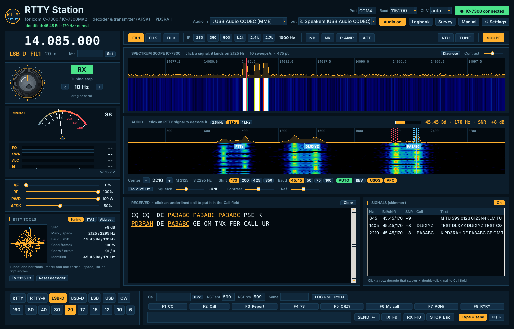

# RTTY Station for the Icom IC-7300 and IC-7300MK2

**English** · [Nederlands](#nederlands)

A free Windows program for RTTY on the Icom IC-7300 and IC-7300MK2: it decodes RTTY from the
radio's USB audio, transmits from the keyboard with AFSK or FSK, and shows the radio's own
spectrum scope as a waterfall, like an SDR panadapter. It is the RTTY companion of
[CW Station](https://github.com/PD3RAH/cw-station) and has the same layout.


*Screenshot with simulated signals.*

## Features

- **RTTY decoder**: mark and space filters matched to the baud rate, ATC (automatic threshold
  correction, so it keeps copying when one tone fades), bit synchronisation on the start bit and
  stop-bit checking. Squelch on the measured signal-to-noise ratio: no garbage from noise.
  45.45 / 50 / 75 / 100 baud, 170 / 200 / 425 / 850 Hz shift, REV, USOS and AFC.
- **Automatic identification (AUTO)**: click a signal and RTTY Station identifies its baud rate
  (45.45/50/75/100), shift (170/200/425/850) and polarity by itself – from an FM-discriminator
  measurement of the tones, the bit-grid alignment of the transitions and trial decoding. It also
  re-checks by itself when copy gets bad.
- **Click to tune**: click a signal in the audio waterfall and the decoder finds the tone pair
  itself. Click a signal in the spectrum scope and the radio is tuned so it lands on 2125/2295 Hz.
- **Skimmer**: decodes up to 6 RTTY signals in the audio passband at the same time, identifies each
  one's baud/shift/polarity and shows their callsigns in the waterfall. Click a signal to decode it in
  the main window with the right settings.
- **CI-V diagnostics**: the scope bar says why there is no scope picture, the scope is re-requested
  automatically, and a Diagnose window shows (and saves) exactly what the radio sends.
- **Transmit**:
  - **AFSK** (default): continuous-phase tones with soft transitions through the USB audio,
    radio in LSB-D. You transmit exactly on the tones you receive.
  - **FSK**: the radio in RTTY mode, keyed through DTR or RTS of the CI-V COM port.
  - PTT through CI-V. Macros F1–F8, live typing (F9 TX / F10 RX) with diddle, line-by-line sending,
    CQ repeat and a TX timeout.
- **Tuning indicator**: crossed-line scope, SNR, good-frame percentage and error counters.
- **Panadapter**: the IC-7300's own spectrum scope over CI-V, with mark and space markers.
- **Radio control**: tuning knob, band and mode buttons (RTTY, RTTY-R, LSB-D, USB-D …), FIL1–3,
  IF width, NB, NR, P.AMP, ATT, ATU and TUNE, AF/RF gain, TX power and AFSK level.
- **Meters**: S-meter, plus digital TX meters for power (W), SWR, ALC and drain current with
  peak hold, and the supply voltage.
- **Automatic radio detection**: IC-7300 (CI-V 94h) or IC-7300MK2 (CI-V B6h).
- **Logbook**: log a QSO with Ctrl+L and export it as ADIF (mode RTTY). Click a callsign in the
  received text to take it over, and look it up on QRZ.com with one click.
- English and Dutch interface, and 6 colour themes. ITA2 table and RTTY abbreviations built in.
- **Update notification** and a **Survey** button, like CW Station.

**Manual:** [English](docs/MANUAL.md) · [Nederlands](docs/HANDLEIDING.md). The manual is also
included in the installer; open it with the **Manual** button.

## Installation

1. Download `RTTYStation-Setup-x.y.z.exe` from [Releases](../../releases) and run it. It needs no
   admin rights, and Python is included.
2. Windows: *Settings → Privacy & security → Microphone →* turn on **"Let desktop apps access
   your microphone"**. The IC-7300 USB audio counts as a microphone.
3. On the first start, enter your callsign under **Settings** and choose AFSK or FSK.

> The installer is not code-signed, so Windows SmartScreen shows *"Windows protected your PC"*.
> Click *More info → Run anyway*. Only download from this repository's Releases page.

Running from source instead: `pip install -r requirements.txt` and then `python src/rtty_station.py`
(Python 3.10+ with tkinter).

## Radio settings

IC-7300, MENU → SET → Connectors:

| Setting | Value |
|---|---|
| CI-V → CI-V USB Port | **Unlink from [REMOTE]** (needed for scope data) |
| CI-V → CI-V USB Baud Rate | **115200** |
| CI-V → CI-V Transceive | ON |
| CI-V → CI-V Address | 94h (default) |
| MOD Input → DATA MOD | **USB** (for AFSK) |
| USB SEND | OFF (PTT goes through CI-V) |
| USB Keying (RTTY) | **DTR** or RTS (only for FSK) |

For FSK, also set the radio's RTTY mark frequency to 2125 Hz, shift to 170 Hz and keying polarity
to Normal. IC-7300MK2: CI-V address B6h (default), and use COM port **A (CI-V)**. MK2 support and
FSK keying are based on Icom's documentation and have not yet been tested on real hardware;
feedback is welcome.

## How it was tested

The demodulator was tested with simulated signals: no errors down to −3 dB SNR (in 2500 Hz),
about 2 % character errors at −6 dB, no errors with ±25 Hz mistuning, REV, 50/75 baud and 850 Hz
shift, and no garbage in two minutes of pure noise with the default squelch. With selective
fading (one tone down to −20 dB), ATC brings the error rate from 26 % to about 7 %. Automatic identification got all 96 combinations of baud, shift and polarity right
down to −4 dB SNR and never mistook noise, carriers or speech for RTTY (40 trials). The scope chain
was tested end to end with a simulated IC-7300 on a virtual serial port (all sweeps received while
decoder and skimmer run), including the error cases. The AFSK
transmitter and the FSK keying timing (22.0 ms bits, 1.5 stop bits) were checked by decoding
the generated signal.

## Survey page

`web/rttystation/enquete.php` is a self-contained PHP page (Dutch/English) that e-mails the
answers. Nothing is stored on the server. Upload it to
`https://www.pd3rah.nl/rttystation/enquete.php` and set `$MAIL_TO` and `$MAIL_FROM` at the top.

## Building the installer

The installer is built on Linux (or by GitHub Actions on every `v*` tag):

```
sudo apt install nsis
pip install zstandard markdown
python3 installer/build_installer.py
```

## Disclaimer

RTTY Station is provided **"as is", without any warranty**. Use is at your own risk; the author is
not liable for any damage or loss, including damage to radio, antenna or computer. You are
responsible for transmitting only where your licence permits. No rights can be derived from the
program or the manual. See the [manual, chapter 17](docs/MANUAL.md#17-disclaimer).

## License

MIT, © 2026 Richard A. Hendriksen (PD3RAH). See [LICENSE](LICENSE). The licenses of the
components bundled in the installer are listed in
[THIRD_PARTY_NOTICES.md](THIRD_PARTY_NOTICES.md).

*Not affiliated with Icom Inc. "Icom", "IC-7300" and "IC-7300MK2" are trademarks of Icom Inc. and are
used only to describe compatibility.*

---

<a name="nederlands"></a>
# Nederlands

Een gratis Windows-programma voor RTTY met de Icom IC-7300 en IC-7300MK2. Het decodeert RTTY uit
de USB-audio van de radio, zendt vanaf het toetsenbord met AFSK of FSK en toont de eigen
spectrumscope van de radio als waterval, net als een SDR-panadapter. Het is de RTTY-broer van
[CW Station](https://github.com/PD3RAH/cw-station), met dezelfde indeling.

## Functies

- **RTTY-decoder**: mark- en spacefilters afgestemd op de baudrate, ATC (automatische
  drempelcorrectie: blijft lezen als één toon wegzakt), bitsynchronisatie op het startbit en
  controle van het stopbit. Squelch op de gemeten signaal-ruisverhouding: geen rommel uit ruis.
  45,45 / 50 / 75 / 100 baud, 170 / 200 / 425 / 850 Hz shift, REV, USOS en AFC.
- **Automatische herkenning (AUTO)**: klik op een signaal en baudrate, shift en polariteit worden
  vanzelf herkend en ingesteld; ook de skimmer herkent elk station apart.
- **CI-V-diagnose**: de scopebalk meldt waarom er geen scopebeeld is, en het venster Diagnose
  laat zien (en bewaart) wat de radio precies stuurt.
- **Klik om af te stemmen**: klik op een signaal in de audio-waterval en de decoder zoekt zelf het
  toonpaar. Klik op een signaal in de spectrumscope en de radio komt zo te staan dat het op
  2125/2295 Hz valt.
- **Skimmer**: decodeert tot 6 RTTY-signalen tegelijk en toont hun call in de waterval.
- **Zenden**: **AFSK** via de USB-audio (radio in LSB-D) of **FSK** (radio in RTTY, sleutelen via
  DTR of RTS). PTT via CI-V. Macro's F1–F8, live typen (F9 TX / F10 RX) met diddle, per regel
  zenden, CQ-herhaling en een TX-time-out.
- **Afstemindicator**: kruisoscilloscoop, signaal-ruis, percentage goede tekens en foutentellers.
- **Panadapter, bediening, meters, logboek (ADIF, mode RTTY)**, NL/EN en 6 kleurthema's, net als
  bij CW Station.

**Handleiding:** [Nederlands](docs/HANDLEIDING.md) · [English](docs/MANUAL.md).

## Installatie

1. Download `RTTYStation-Setup-x.y.z.exe` bij [Releases](../../releases) en start het bestand. Er
   zijn geen beheerdersrechten nodig en Python zit erbij.
2. Windows: *Instellingen → Privacy en beveiliging → Microfoon →* zet **"Desktop-apps toegang
   geven tot je microfoon"** aan.
3. Vul bij de eerste start je call in onder **Instellingen** en kies AFSK of FSK.

Zie de tabel hierboven voor de instellingen van de radio. Je instellingen en je logboek staan in
`%APPDATA%\RTTYStation` en blijven bewaard als je het programma verwijdert of bijwerkt.

## Disclaimer

RTTY Station wordt geleverd **"zoals het is", zonder enige garantie**. Gebruik is op eigen risico;
de maker is niet aansprakelijk voor schade of verlies, ook niet aan radio, antenne of computer. Je
bent zelf verantwoordelijk dat je alleen uitzendt waar je machtiging dat toestaat. Aan het
programma en de handleiding kunnen geen rechten worden ontleend. Zie de
[handleiding, hoofdstuk 17](docs/HANDLEIDING.md#17-disclaimer).

Windows kan bij het installeren *"Uw pc wordt beschermd"* melden: klik op *Meer informatie →
Toch uitvoeren*. Download alleen van de Releases-pagina van deze repository.

## Licentie

MIT, © 2026 Richard A. Hendriksen (PD3RAH). Niet gelieerd aan Icom Inc.
