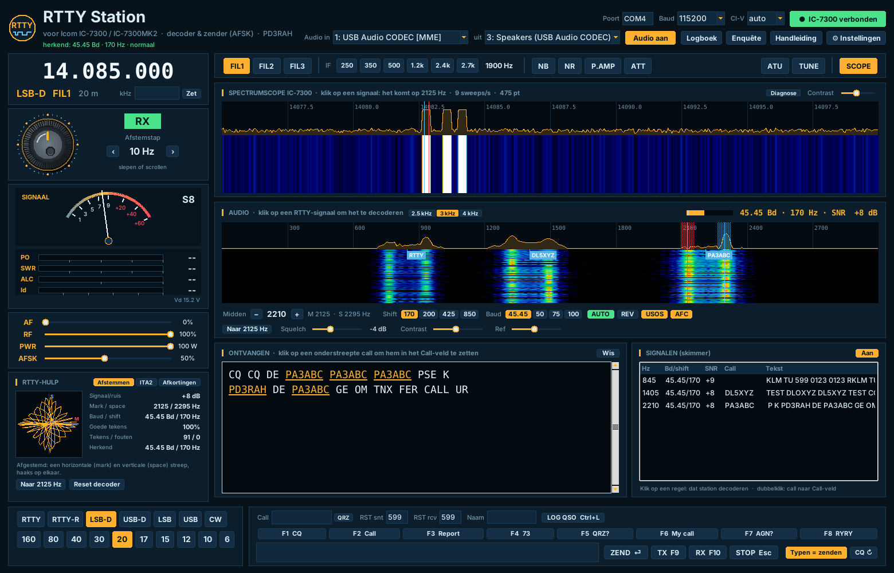
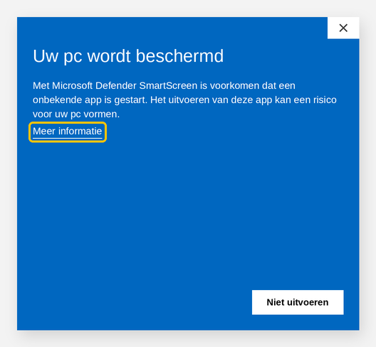
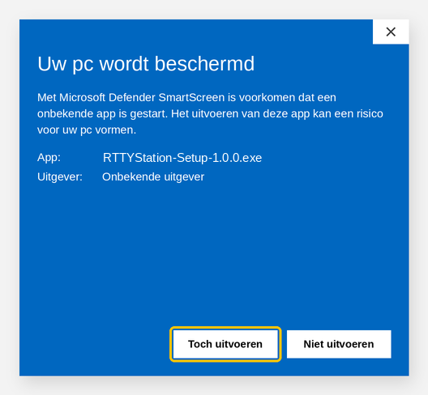

# RTTY Station – Handleiding

*Versie 1.1.0 · voor de Icom IC-7300 en IC-7300MK2 · © 2026 Richard A. Hendriksen (PD3RAH)*

*Schermafbeelding met gesimuleerde signalen.*

RTTY Station is een gratis Windows-programma voor RTTY (radioteletype) met je Icom IC-7300 of IC-7300MK2. Het programma:

- **decodeert** RTTY uit de USB-audio van de radio, ook meerdere stations tegelijk;
- **herkent** zelf de baudrate, shift en polariteit van een signaal en stelt de decoder daarop in;
- **zendt** RTTY vanaf je toetsenbord: met **AFSK** via de USB-audio of met **FSK** via de RTTY-mode van de radio;
- toont de **spectrumscope** van de radio als waterval, net als een SDR;
- **bedient** de radio: frequentie, mode, filters, vermogen en tuner;
- toont een **S-meter** en digitale **zendmeters** (vermogen, SWR, ALC, stroom);
- houdt een **logboek** bij met ADIF-export.

Bijna al het RTTY-verkeer op de amateurbanden is 45,45 baud met 170 Hz shift. RTTY Station herkent ook 50, 75 en 100 baud en shifts van 200, 425 en 850 Hz, en kiest die vanzelf (knop **AUTO**).

---

## Inhoud

1. [Wat heb je nodig](#1-wat-heb-je-nodig)
2. [Installeren](#2-installeren)
3. [De radio instellen](#3-de-radio-instellen)
4. [De eerste keer starten](#4-de-eerste-keer-starten)
5. [Het scherm](#5-het-scherm)
6. [Afstemmen](#6-afstemmen)
7. [RTTY ontvangen](#7-rtty-ontvangen)
8. [RTTY zenden](#8-rtty-zenden)
9. [AFSK of FSK](#9-afsk-of-fsk)
10. [Meters, vermogen en tuner](#10-meters-vermogen-en-tuner)
11. [Filters en ontvangst](#11-filters-en-ontvangst)
12. [Logboek](#12-logboek)
13. [Instellingen en macro's](#13-instellingen-en-macros)
14. [Sneltoetsen](#14-sneltoetsen)
15. [Problemen oplossen](#15-problemen-oplossen)
16. [Bestanden, bijwerken en verwijderen](#16-bestanden-bijwerken-en-verwijderen)
17. [Disclaimer](#17-disclaimer)

---

## 1. Wat heb je nodig

- Een pc met **Windows 10 of 11**.
- Een **Icom IC-7300** of **IC-7300MK2**.
- Een **USB-kabel** tussen radio en pc: USB-B bij de IC-7300, USB-C bij de MK2.
- De **USB-driver van Icom**, te downloaden van de Icom-website. Windows 11 installeert die vaak zelf.

Python of andere software heb je niet nodig; alles zit in de installer. Een extra interface is ook niet nodig: audio, CI-V en het sleutelen gaan allemaal over die ene USB-kabel.

## 2. Installeren

1. Download **RTTYStation-Setup-x.y.z.exe** bij *Releases* op GitHub en start het bestand.
2. Krijg je een blauw scherm **"Uw pc wordt beschermd"**, lees dan het kader hieronder.
3. Kies je taal, lees en **accepteer de disclaimer** en klik door de installatie. Beheerdersrechten zijn niet nodig.
4. Laat op het laatste scherm het vinkje **"Microfoon-privacyinstelling openen"** aan en zet daar **"Desktop-apps toegang geven tot je microfoon"** aan.
   Windows ziet de USB-audio van de radio als microfoon. Zonder deze instelling krijgt RTTY Station geen geluid binnen.

Er komt een snelkoppeling **RTTY Station** op je bureaublad en in het Startmenu. RTTY Station staat los van CW Station: je kunt beide naast elkaar installeren (maar niet tegelijk met de radio verbinden).

### Melding "Uw pc wordt beschermd" (Windows SmartScreen)

Bij het starten van de installer of een update toont Windows vaak deze melding:

1. Klik op **Meer informatie**.
2. Er verschijnt nu een knop **Toch uitvoeren**. Klik daarop.

**Waarom krijg je deze melding?** RTTY Station is gratis hobbysoftware zonder (betaald) digitaal certificaat. Windows kent het programma daardoor niet, en de uitgever staat als *"Onbekende uitgever"* vermeld. De melding betekent niet dat er een virus in zit. Download de installer alleen van de officiële plek: de *Releases*-pagina op **github.com/PD3RAH/rtty-station**.

Ook een virusscanner kan het bestand tegenhouden of in quarantaine zetten. Zet het dan terug uit de quarantaine, of voeg de map `%LOCALAPPDATA%\RTTYStation` toe aan de uitzonderingen.

## 3. De radio instellen

### CI-V (beide modellen)

**IC-7300**, ga naar **MENU → SET → Connectors → CI-V**:

| Instelling | Waarde |
|---|---|
| CI-V Address | 94h (standaard) |
| CI-V Transceive | ON |
| CI-V USB Port | **Unlink from [REMOTE]** |
| CI-V USB Baud Rate | **115200** |
| CI-V USB Echo Back | OFF |

**IC-7300MK2**: CI-V Address B6h (standaard), CI-V Transceive ON, CI-V USB (A) Echo Back OFF. De MK2 heeft twee COM-poorten. Kies in RTTY Station de poort die Windows **"IC-7300MK2 Serial Port A (CI-V)"** noemt; Apparaatbeheer laat zien welk nummer dat is.

> Ondersteuning voor de MK2 is gebouwd op de documentatie van Icom en nog niet met een echte MK2 getest. Laat je via de knop **Enquête** weten of het werkt?

### Audio (nodig voor ontvangen en voor AFSK)

Ga naar **MENU → SET → Connectors**:

| Instelling | Waarde |
|---|---|
| ACC/USB Output Select | AF |
| ACC/USB AF Output Level | ongeveer **50 %** |
| MOD Input → **DATA MOD** | **USB** |
| USB MOD Level | ongeveer **50 %** (zie hoofdstuk 8 voor het afregelen) |
| USB SEND | OFF |

RTTY Station schakelt de zender via CI-V. **USB SEND** mag dus uit blijven.

### Extra voor FSK

Wil je met **FSK** zenden (zie hoofdstuk 9), stel dan ook in:

| Instelling | Waarde |
|---|---|
| Connectors → **USB Keying (RTTY)** | **DTR** (of RTS; moet gelijk zijn aan *FSK-lijn* in RTTY Station) |
| Connectors → USB Keying (CW) | OFF |
| RTTY Mark Frequency | **2125** |
| RTTY Shift Width | **170** |
| RTTY Keying Polarity | Normal |

De drie RTTY-instellingen staan in het menu van de radio onder **SET → Function** (de indeling kan per firmwareversie iets verschillen). De mark-frequentie in de radio moet gelijk zijn aan de **Mark-toon** in RTTY Station.

### Scope

Zet de **scope** op het scherm van de radio aan (knop M.SCOPE). Alleen dan stuurt de radio scope-gegevens naar de pc. Zet bij de IC-7300 de **CI-V USB Baud Rate** op een vaste **115200**, niet op *Auto*.

Werkt de scope niet, kijk dan in de titelbalk van de scope (hoofdstuk 11) of klik op **Diagnose**.

## 4. De eerste keer starten

1. Start **RTTY Station**. Het venster **Instellingen** opent vanzelf.
2. Vul je **call**, **naam** en **QTH** in, kies **taal** en **kleur**, en kies bij **Zenden** de **methode** (AFSK is de standaard). Klik op **Opslaan**.
3. Kies rechtsboven de **Poort**, bijvoorbeeld COM4. Laat **Baud** op 115200 en **CI-V** op **auto** staan.
4. Klik op **● Verbind radio**. Wordt de knop groen met *"IC-7300 verbonden"* of *"IC-7300MK2 verbonden"*, dan is de verbinding gelukt.
5. Kies bij **Audio in** de **USB Audio CODEC** (de *microfoon*) en bij **uit** ook de **USB Audio CODEC** (de *luidspreker*). Klik op **Start audio**.

Het programma onthoudt deze keuzes voor de volgende keer.

## 5. Het scherm

| Deel | Wat het doet |
|---|---|
| **Kopbalk** | Klokken (lokaal en UTC), verbinding, audio in en uit, logboek, enquête, handleiding en instellingen |
| **Frequentie** | De VFO-frequentie, mode (bijvoorbeeld LSB-D of RTTY), filter en band. Typ een frequentie in kHz en klik op **Zet** |
| **Afstemknop** | Afstemmen met slepen of scrollen. Ernaast staan het RX/TX-lampje en de stapgrootte |
| **S-meter en zendmeters** | Signaalsterkte; tijdens zenden ook PO, SWR, ALC, Id en Vd |
| **AF / RF / PWR / AFSK** | Volume, RF-gain en zendvermogen van de radio, en het niveau van het AFSK-signaal |
| **RTTY-hulp** | Afstemindicator (kruisoscilloscoop) met signaal-ruis en foutentellers, de ITA2-tabel en RTTY-afkortingen |
| **Functiebalk** | FIL1–3, IF-breedte, NB, NR, P.AMP, ATT, ATU, TUNE en SCOPE |
| **Spectrumscope** | De scope van de radio als spectrum en waterval, met mark (rood) en space (blauw) als lijntjes |
| **Audio-waterval** | De audio uit de radio. Rood = mark, blauw = space. Kies het bereik met **2.5 / 3 / 4 kHz** |
| **Ontvangen** | Gedecodeerde tekst. Je eigen verzonden tekst staat er in een andere kleur |
| **Signalen (skimmer)** | Alle RTTY-stations in de audio, met call, signaal-ruis en tekst |
| **Onderbalk** | Mode- en bandknoppen, QSO-gegevens, macro's en het zendveld |

## 6. Afstemmen

- **Afstemknop**: sleep met de muis rond de knop, of gebruik het scrollwiel. Met de knoppen **‹ ›** kies je de stap, van 10 Hz tot 5 kHz.
- **Bandknoppen** (160 t/m 6 m) springen naar het RTTY-deel van die band.
- **Klik in de spectrumscope** op een RTTY-signaal (midden tussen de twee tonen). De radio stemt zo af dat het signaal precies op **2125 / 2295 Hz** komt, de standaardtonen. Dat werkt in LSB(-D), USB(-D), RTTY en RTTY-R.
- De knop **Naar 2125 Hz** doet hetzelfde voor het signaal dat je nu decodeert: de VFO schuift zo, dat het signaal op de standaardtonen komt. Handig bij FSK, want dan zend je precies op de frequentie van het tegenstation.

## 7. RTTY ontvangen

1. Zet de radio in **LSB-D** (voor AFSK) of **RTTY** (voor FSK).
2. Stem af op een RTTY-signaal: je ziet twee sporen naast elkaar in de waterval.
3. **Klik in de audio-waterval** op het signaal. RTTY Station zoekt zelf het toonpaar en zet de rode (mark) en blauwe (space) lijn op de twee sporen.
4. Staat **AUTO** aan (standaard), dan herkent het programma binnen ongeveer een seconde de **baudrate, shift en polariteit** en stelt de decoder daarop in. De statusregel bovenaan meldt bijvoorbeeld *"herkend: 45.45 Bd · 170 Hz · normaal"*.
5. De tekst verschijnt in **Ontvangen**. Rechtsboven in het audiopaneel zie je baudrate, shift en de **signaal-ruisverhouding**.

### Automatische herkenning (AUTO)

Het programma bewaart steeds de laatste 6 seconden audio. Na een klik gebeurt het volgende:

1. In het spectrum zoekt het het toonpaar bij je klik.
2. Mark en space worden precies gemeten met een FM-discriminator. Dat geeft het midden en de shift. Ligt de meting tussen twee standaardshifts in (bijvoorbeeld 170 en 200 Hz), dan kiest het de shift waarbij de toonfilters de meeste energie opvangen.
3. De baudrate volgt uit de plaats van de mark/space-overgangen: die liggen op het bitraster. Een 50-baud-signaal past ook op 100 baud; dan wint de laagste.
4. De polariteit (REV) wordt bepaald door de audio proef te decoderen, normaal en omgekeerd.

Werkt het niet, dan meldt de statusregel *"geen RTTY herkend"* en blijven je instellingen staan; stel ze dan met de hand in.

AUTO werkt ook zonder klik:

- Staat er bij het huidige midden een nog onbekend signaal, dan wordt het vanzelf herkend.
- Leest de decoder slecht terwijl er een duidelijk signaal is (veel tekens met een fout stopbit), dan herkent het programma het signaal opnieuw en stelt het bij (*"bijgesteld: …"*).
- Na een klik in de spectrumscope wacht het programma tot de audio van het nieuwe signaal binnen is.

In de tests werd elke combinatie van 45,45/50/75/100 baud, 170/200/425/850 Hz shift en normaal/omgekeerd goed herkend tot een signaal-ruisverhouding van −4 dB (45,45 baud/170 Hz zelfs tot −7 dB). Pure ruis, draaggolven en spraak werden nooit als RTTY aangezien.

**Instellingen van de decoder:**

| Knop | Uitleg |
|---|---|
| **Midden − / +** | Het midden tussen mark en space in stappen van 5 Hz verschuiven |
| **Shift 170 / 200 / 425 / 850** | Afstand tussen mark en space. Op de amateurbanden bijna altijd 170 |
| **Baud 45.45 / 50 / 75 / 100** | Snelheid. Op de amateurbanden bijna altijd 45,45 |
| **AUTO** | Baudrate, shift en polariteit automatisch herkennen (zie hieronder). Zet AUTO uit als je alles met de hand wilt instellen |
| **REV** | Mark en space omdraaien. Nodig als je alleen onzin leest terwijl het signaal mooi binnenkomt |
| **USOS** | *Unshift on space*: na een spatie terug naar letters. Bijna iedereen gebruikt dit; laat het aan |
| **AFC** | Volgt een signaal dat iets verloopt |
| **Squelch** | Onder deze signaal-ruisverhouding wordt niets geschreven. Standaard −4 dB: dan komt er geen rommel uit ruis. Lager zetten helpt bij heel zwakke signalen |
| **Contrast / Ref** | Alleen de weergave van de waterval |

**Mark en space in USB.** RTTY Station houdt zelf rekening met de zijband: in LSB en RTTY is mark de lage toon, in USB en RTTY-R de hoge. **REV** heb je alleen nodig als het tegenstation zelf omgekeerd zendt.

**De decoder.** Het programma meet mark en space elk apart (ATC, automatische drempelcorrectie). Daardoor blijft het lezen als een van de twee tonen wegzakt door selectieve fading. Tekens met een fout stopbit worden niet geschreven.

**Skimmer.** Het paneel *Signalen* zoekt alle RTTY-signalen in de audio en decodeert er tot 6 tegelijk. Met AUTO aan zoekt de skimmer naar alle standaardshifts en herkent hij elk station apart. De kolom **Bd/shift** toont het resultaat, bijvoorbeeld `45.45/170` of `50/170 R` (R = omgekeerd). Een station verschijnt pas in de lijst als het herkend is. De call staat ook als label in de waterval.

- Klik op een regel: het hoofdvenster gaat dat station decoderen, meteen met de juiste baud, shift en polariteit.
- Dubbelklik op een regel: de call komt in het veld **Call**.

**RTTY-hulp** (linksonder) heeft drie tabbladen:

- **Afstemmen** toont de **kruisoscilloscoop**: goed afgestemd zie je een **horizontale** streep (mark) en een **verticale** streep (space). Ernaast staan de signaal-ruisverhouding, de tonen, het percentage goede tekens, de tellers voor tekens en fouten, en wat AUTO het laatst **herkend** heeft. **Reset decoder** laat de decoder opnieuw beginnen.
- **ITA2** is de tabel van de Baudot-code: de vijf bits van elk teken, de letter en het cijfer/leesteken.
- **Afkortingen** is een lijst met de meest gebruikte RTTY-afkortingen en Q-codes.

**Calls overnemen.** Calls in de ontvangen tekst zijn onderstreept. Klik erop en de call staat in het veld **Call**. Met **QRZ** open je de QRZ.com-pagina van dat station.

## 8. RTTY zenden

> Zend alleen op frequenties en banden waarvoor je machtiging geldig is. Luister eerst of de frequentie vrij is.

Er zijn twee manieren om te zenden.

**Met macro's of een regel tekst.** De zender gaat aan, zendt de tekst en gaat daarna vanzelf terug naar ontvangst.

- **Macro's F1–F8**: druk op de F-toets of klik op de knop. F1 is je CQ-roep.
- **Typ** een regel in het zendveld onderaan en druk op **Enter** of klik op **ZEND**.
- **CQ ↻**: staat deze aan, dan herhaalt F1 zichzelf na een pauze. De pauze stel je in bij Instellingen.

**Live typen.** Zo werkt RTTY traditioneel: je zendt terwijl je typt.

- **TX (F9)**: de zender gaat aan en blijft aan. Staat **Typen = zenden** aan, dan gaat elk teken dat je typt direct de lucht in. Is er even niets te zenden, dan zendt het programma *diddle* (LTRS-tekens), zodat de ontvangers in sync blijven.
- Macro's tijdens een live-uitzending worden achter de tekst gezet; de zender blijft aan.
- **RX (F10)**: eerst wordt alles in de wachtrij nog verzonden, daarna gaat de zender uit.
- **STOP (Esc)**: de zender gaat direct uit; de wachtrij wordt gewist.

Staat **Typen = zenden** uit, dan zend je tijdens TX (F9) per regel: typ een regel en druk op Enter.

Rechtsboven in het QSO-veld zie je tijdens het zenden hoeveel tekens er nog in de wachtrij staan. Elke uitzending begint en eindigt met CR/LF (een nieuwe regel); dat kun je uitzetten bij Instellingen. Een **TX-time-out** (standaard 300 s) zet de zender uit als je vergeet op RX te drukken.

**Tekens.** RTTY (ITA2/Baudot) kent alleen hoofdletters, cijfers en een paar leestekens: `- ? : ( ) . , ' / $ ! & # ; "`. Kleine letters worden hoofdletters; `=` wordt `-` en `+` wordt `PLUS`. Andere tekens worden overgeslagen.

**AFSK-niveau afregelen** (alleen bij AFSK):

1. Zet **PWR** op het vermogen dat je wilt en zet de radio-meter op **ALC**.
2. Zend op een vrije frequentie (of in een dummyload) bijvoorbeeld F8 (RYRY).
3. Draai de schuif **AFSK** (of *USB MOD Level* in de radio) zo, dat het vermogen net zijn ingestelde waarde haalt en de **ALC** nog maar net uitslaat. Een te hoog niveau geeft een vervormd en breed signaal.

RTTY is een continu signaal: de zender staat de hele uitzending op vol vermogen. Zet bij lange uitzendingen het vermogen lager (bijvoorbeeld 50 W).

**Testen of je signaal goed uitkomt:** roep een paar keer CQ met F1 en kijk daarna op **reversebeacon.net** (die decodeert ook RTTY) of je call gemeld wordt.

## 9. AFSK of FSK

Kies de methode bij **⚙ Instellingen → Zenden**.

| | **AFSK** (standaard) | **FSK** |
|---|---|---|
| Radio-mode | **LSB-D** (of USB-D) | **RTTY** (of RTTY-R) |
| Hoe | RTTY Station maakt de twee tonen als audio en stuurt ze via de USB-audio naar de radio | De radio maakt het signaal zelf; RTTY Station schakelt mark/space via de DTR- of RTS-lijn van de COM-poort |
| Zendtonen | De tonen waarop je ontvangt (je zendt dus precies waar je luistert) | De mark-toon en shift van de radio (2125 / 170 Hz). Gebruik **Naar 2125 Hz** of klik in de scope om op het tegenstation te komen |
| Filters | Gebruik in LSB-D het brede filter (2.4k); dan staan beide tonen goed in de doorlaat | De smalle RTTY-filters van de radio (bijvoorbeeld 250 of 350 Hz) liggen precies om de tonen; goed tegen storing |
| Instellen in de radio | DATA MOD = USB | USB Keying (RTTY) = DTR of RTS, RTTY-instellingen 2125 / 170 / Normal |

Bij het zenden zet RTTY Station de radio zelf in de juiste mode: bij AFSK naar LSB-D (of USB-D als je in USB stond), bij FSK naar RTTY.

**FSK omkeren.** Komt je FSK-signaal omgekeerd uit (de tegenpartij moet REV aanzetten), zet dan **FSK omkeren** aan bij Instellingen, of zet *RTTY Keying Polarity* in de radio op *Reverse*.

> FSK via DTR/RTS is gebaseerd op de documentatie van Icom en nog niet op een echte IC-7300 getest. AFSK is uitgebreid getest. Laat je via de **Enquête** weten hoe FSK werkt?

## 10. Meters, vermogen en tuner

- **S-meter**: de signaalsterkte die de radio meet.
- **Zendmeters** (alleen tijdens zenden). Het witte streepje is de piekwaarde.

  | Meter | Betekenis | Goed |
  |---|---|---|
  | **PO** | Uitgangsvermogen in watt | wat je hebt ingesteld |
  | **SWR** | Staandegolfverhouding | onder 1,5; oranje vanaf 1,5, rood vanaf 2,0 |
  | **ALC** | Automatische niveauregeling | bij AFSK net zichtbaar, niet in het rood |
  | **Id** | Stroom van de eindtrap | bij 100 W ongeveer 15–20 A |
  | **Vd** | Voedingsspanning, ook tijdens ontvangen | ongeveer 13,8 V |

- **PWR**: stelt het zendvermogen in (0–100 W).
- **AFSK**: het niveau van het AFSK-signaal naar de radio (zie hoofdstuk 8).
- **ATU**: zet de ingebouwde antennetuner aan of uit.
- **TUNE**: laat de tuner afstemmen. **Let op:** de radio zendt dan even een draaggolf. Gebruik een vrije frequentie.

De meterwaarden zijn een benadering, omgerekend volgens de tabellen van Icom.

## 11. Filters en ontvangst

| Knop | Uitleg |
|---|---|
| **FIL1 / FIL2 / FIL3** | Kiest het filter van de radio |
| **IF 250 … 2.7k** | Stelt de breedte van het actieve filter in (in SSB, SSB-D en RTTY) |
| **NB / NR** | Ruisonderdrukking van de radio. Zet NR bij RTTY liever uit: het kan de tonen vervormen |
| **P.AMP** | Voorversterker: uit, 1 of 2 |
| **ATT** | Verzwakker van 20 dB |
| **SCOPE** | Zet het ophalen van scope-gegevens aan of uit |

**Tip voor de skimmer:** gebruik een breed filter (IF 2.4k). Dan staan er meer stations tegelijk in de audio.

### Scope werkt niet: de melding en de knop Diagnose

De titelbalk van de spectrumscope zegt wat er aan de hand is:

| Melding | Betekenis en oplossing |
|---|---|
| *… sweeps/s · 475 pt* | Alles werkt |
| *radio antwoordt, maar stuurt geen scope* | De verbinding is goed, maar de radio stuurt geen scope-gegevens. IC-7300: **CI-V USB Port = Unlink from [REMOTE]** en **CI-V USB Baud Rate = 115200** (niet Auto). Zet de scope aan op het scherm van de radio (M.SCOPE) en sluit het menu van de radio. MK2: COM-poort **A (CI-V)** |
| *scope-data komt binnen maar is onleesbaar* | De radio stuurt wel gegevens, maar in een vorm die het programma niet kent. Klik op **Diagnose → Opslaan** en stuur het bestand op via de enquête |
| *de radio stuurt niets terug* | Verkeerde COM-poort, baudrate of CI-V-adres |

Zolang er geen scopebeeld is, vraagt het programma de scope elke 5 seconden opnieuw aan. Heeft de radio de eerste aanvraag gemist, dan komt het beeld zo vanzelf.

**Diagnose** (knop in de scopebalk) toont live wat er via CI-V binnenkomt: bytes en frames per seconde, het aantal scope-frames en volledige sweeps, de frames per commando en de laatste ruwe frames. Met **Opslaan** schrijf je alles naar `%APPDATA%\RTTYStation\civ_diagnose.txt`; met **Kopiëren** zet je het op het klembord. **Scope opnieuw aanvragen** stuurt het scope-commando direct nog een keer.

## 12. Logboek

1. Vul onderaan in: **Call**, **RST snt** (gegeven), **RST rcv** (ontvangen) en eventueel de **Naam**.
2. Klik op **LOG QSO** of druk op **Ctrl+L**. Datum, tijd (UTC), band, frequentie en mode **RTTY** worden automatisch toegevoegd.
3. Met de knop **Logboek** in de kopbalk zie je alle QSO's. Met **Exporteer ADIF…** maak je een bestand voor je logprogramma, LoTW of eQSL.

## 13. Instellingen en macro's

Open **⚙ Instellingen**:

- **Taal** (Nederlands/English) en **Kleur**: worden direct toegepast.
- **Mijn call, Mijn naam, Mijn QTH**: worden gebruikt in de macro's.
- **CQ-herhaling**: de pauze in seconden tussen twee CQ-roepen.
- **Zenden**:

  | Instelling | Uitleg |
  |---|---|
  | **Methode** | AFSK (LSB-D) of FSK (RTTY-mode, DTR/RTS) |
  | **FSK-lijn** | DTR of RTS; gelijk aan *USB Keying (RTTY)* in de radio |
  | **FSK omkeren** | Mark en space op de sleutellijn omdraaien |
  | **Stopbits** | 1, 1,5 (standaard) of 2 |
  | **Mark-toon** | 2125 Hz (standaard), 1615 of 1275 Hz; gelijk aan *RTTY Mark Frequency* in de radio |
  | **Diddle** | LTRS zenden als de wachtrij leeg is |
  | **CR/LF** | Een nieuwe regel voor en na elke uitzending |
  | **TX-time-out** | Maximale zendtijd in seconden |

- **Macro's**: per F-toets een korte naam en een tekst. Je kunt deze variabelen gebruiken:

| Variabele | Wordt |
|---|---|
| `{MYCALL}` | jouw call |
| `{MYNAME}` / `{MYQTH}` | jouw naam / QTH |
| `{CALL}` | de call in het veld Call |
| `{NAME}` | de naam in het veld Naam |
| `{RST}` | het gegeven rapport |
| `{CR}` | een nieuwe regel |

## 14. Sneltoetsen

| Toets | Functie |
|---|---|
| **F1 … F8** | Macro zenden |
| **F9** | Zender aan (live typen) |
| **F10** | Na de wachtrij terug naar ontvangst |
| **Enter** | Tekst in het zendveld zenden |
| **Esc** | Zenden direct stoppen |
| **Ctrl+L** | QSO loggen |
| **Scrollwiel** op knop of frequentie | Afstemmen |

## 15. Problemen oplossen

| Probleem | Oplossing |
|---|---|
| *"Kan COM4 niet openen"* | Ander programma sluiten dat de poort gebruikt (CW Station, WSJT-X, MMTTY, logprogramma); juiste poort kiezen in Apparaatbeheer |
| *"geen antwoord van de radio"* | Baud 115200; CI-V-adres op auto; bij de MK2 poort **A** kiezen; radio aan? |
| Radio zendt meteen bij verbinden | **USB SEND** en **USB Keying (CW)** op **OFF** zetten in het menu van de radio |
| Scope blijft zwart | Lees de melding in de titelbalk van de scope (hoofdstuk 11). IC-7300: *CI-V USB Port = Unlink*, USB-baud **115200** (niet Auto). Beide modellen: scope aan op de radio. Helpt dat niet: **Diagnose → Opslaan** en het bestand opsturen |
| Verkeerde baud of shift na een klik | Precies op het signaal klikken; het signaal moet een paar seconden in de audio staan. Of AUTO uit en met de hand instellen |
| Geen audio of lege waterval | Microfoontoegang in Windows aanzetten; bij *Audio in* de **USB Audio CODEC** kiezen; *ACC/USB AF Output Level* hoger zetten |
| Melding *"Audio: geen geluid ontvangen"* | Windows blokkeert de geluidskaart of de radio stuurt geen audio. Klik op de melding om de microfoon-instellingen van Windows te openen |
| Alleen onzin, terwijl het signaal mooi in beeld is | **REV** aanzetten; shift en baud controleren (bijna altijd 170 Hz / 45,45); precies op het signaal klikken |
| Veel cijfers waar letters horen (of andersom) | **USOS** aan- of uitzetten, afhankelijk van het tegenstation |
| Rommel uit ruis | **Squelch** hoger zetten |
| Zwakke signalen worden niet geschreven | **Squelch** lager zetten; IF-filter smaller zetten (in RTTY-mode 250 of 350 Hz) |
| Zenden met AFSK: geen vermogen | *DATA MOD = USB* in de radio; bij *uit* de **USB Audio CODEC** kiezen; schuif **AFSK** en *USB MOD Level* hoger |
| AFSK-signaal breed of vervormd | AFSK-niveau lager zetten tot de ALC net uitslaat; NR/compressor uit |
| FSK: zender aan, maar geen RTTY | *USB Keying (RTTY)* in de radio gelijk aan **FSK-lijn**; radio in RTTY-mode |
| Tegenpartij leest jou alleen met REV | Bij FSK: **FSK omkeren**. Bij AFSK: zend in LSB-D, niet in USB-D zonder REV |
| Melding *"NG"* | De radio weigert een commando, bijvoorbeeld IF-breedte in AM of FM |
| Programma start niet | Bekijk `%APPDATA%\RTTYStation\error.log` en stuur het mee via de enquête |

## 16. Bestanden, bijwerken en verwijderen

- **Instellingen en logboek**: `%APPDATA%\RTTYStation\` (`settings.json` en `logbook.adi`). Deze blijven bewaard bij bijwerken en verwijderen.
- **Bijwerken**: bij het starten kijkt RTTY Station of er een nieuwe versie is. Is die er, dan verschijnt een melding en de knop **⬆ Nieuwe versie** in de kopbalk; die opent de downloadpagina. Start daar de nieuwe **Setup** of de kleine **Update** over de oude versie heen. Het controleren zet je uit bij Instellingen.
- **Fouten**: interne fouten worden opgeslagen in `%APPDATA%\RTTYStation\error.log`. Stuur dat bestand mee als je een probleem meldt.
- **Verwijderen**: via *Windows Instellingen → Apps → RTTY Station*.
- **Enquête**: met de knop **Enquête** laat je weten wat goed werkt en wat beter kan. Je antwoorden gaan rechtstreeks naar de maker.

## 17. Disclaimer

RTTY Station is gratis software en wordt geleverd **"zoals het is"** (*as is*), **zonder enige garantie**. Er is geen garantie dat het programma foutloos werkt, en ook niet dat het geschikt is voor een bepaald doel.

- **Gebruik is op eigen risico.** De maker is niet aansprakelijk voor schade of verlies door het gebruik van dit programma, of doordat het niet gebruikt kan worden. Denk aan schade aan je radio, antenne of computer, verlies van gegevens, of storing.
- **Jij bent verantwoordelijk voor wat je uitzendt.** Zend alleen op frequenties, banden en met vermogens die je machtiging toestaat, en houd je aan de regels van je land.
- **Aan dit programma, de handleiding en de vertalingen kunnen geen rechten worden ontleend.** Functies kunnen zonder aankondiging veranderen.
- De meterwaarden (vermogen, SWR, ALC, stroom, spanning) zijn een benadering en geen meetinstrument.
- RTTY Station is **niet gelieerd** aan Icom Inc. "Icom", "IC-7300" en "IC-7300MK2" zijn merknamen van Icom Inc.

De volledige juridische tekst is de **MIT-licentie** (bestand `LICENSE`). Bij verschil tussen deze samenvatting en de licentie geldt de licentie.

---

*RTTY Station is vrije software onder de MIT-licentie. Het programma is niet gelieerd aan Icom Inc.; "Icom", "IC-7300" en "IC-7300MK2" zijn merknamen van Icom Inc.*
