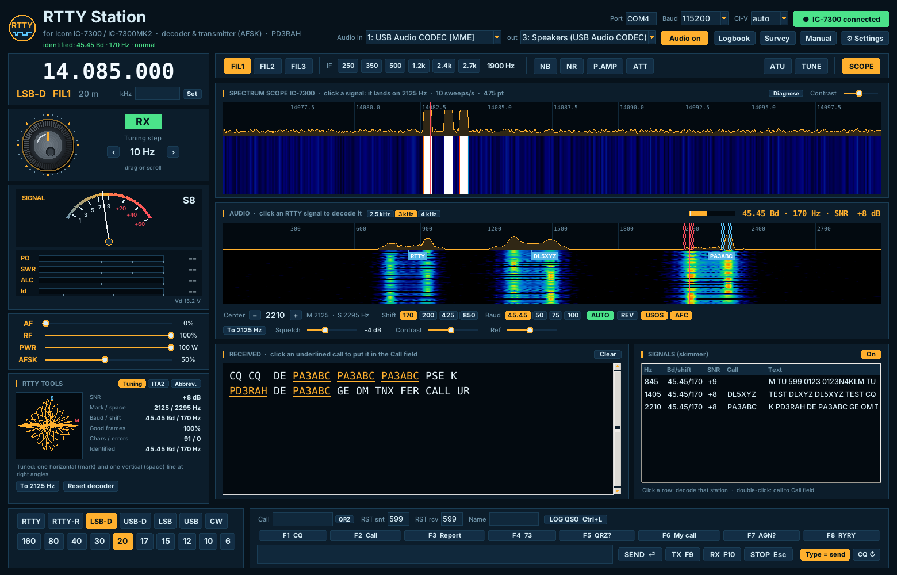
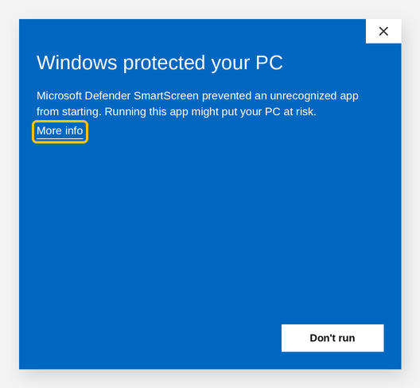
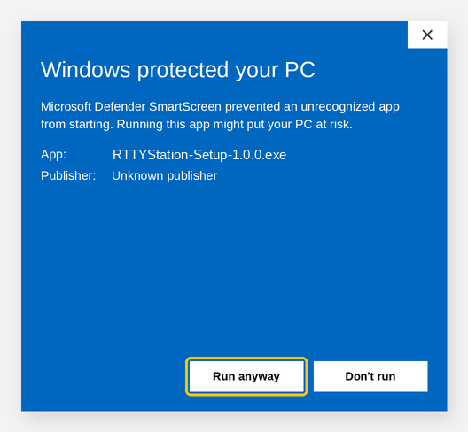

# RTTY Station – Manual

*Version 1.1.0 · for the Icom IC-7300 and IC-7300MK2 · © 2026 Richard A. Hendriksen (PD3RAH)*

*Screenshot with simulated signals.*

RTTY Station is a free Windows program for RTTY (radioteletype) with your Icom IC-7300 or IC-7300MK2. It:

- **decodes** RTTY from the radio's USB audio, including several stations at the same time;
- **identifies** the baud rate, shift and polarity of a signal by itself and sets up the decoder;
- **transmits** RTTY from your keyboard: with **AFSK** through the USB audio or with **FSK** through the radio's RTTY mode;
- shows the radio's **spectrum scope** as a waterfall, like an SDR;
- **controls** the radio: frequency, mode, filters, power and tuner;
- shows an **S-meter** and digital **TX meters** (power, SWR, ALC, current);
- keeps a **logbook** with ADIF export.

Almost all RTTY on the amateur bands is 45.45 baud with 170 Hz shift. RTTY Station also identifies 50, 75 and 100 baud and 200, 425 and 850 Hz shift, and selects them by itself (**AUTO** button).

---

## Contents

1. [What you need](#1-what-you-need)
2. [Installation](#2-installation)
3. [Setting up the radio](#3-setting-up-the-radio)
4. [First start](#4-first-start)
5. [The screen](#5-the-screen)
6. [Tuning](#6-tuning)
7. [Receiving RTTY](#7-receiving-rtty)
8. [Transmitting RTTY](#8-transmitting-rtty)
9. [AFSK or FSK](#9-afsk-or-fsk)
10. [Meters, power and tuner](#10-meters-power-and-tuner)
11. [Filters and reception](#11-filters-and-reception)
12. [Logbook](#12-logbook)
13. [Settings and macros](#13-settings-and-macros)
14. [Keyboard shortcuts](#14-keyboard-shortcuts)
15. [Troubleshooting](#15-troubleshooting)
16. [Files, updating and uninstalling](#16-files-updating-and-uninstalling)
17. [Disclaimer](#17-disclaimer)

---

## 1. What you need

- A PC with **Windows 10 or 11**.
- An **Icom IC-7300** or **IC-7300MK2**.
- A **USB cable** between radio and PC: USB-B on the IC-7300, USB-C on the MK2.
- The **Icom USB driver**, available from the Icom website. Windows 11 often installs it by itself.

You do not need Python or other software; everything is in the installer. No extra interface is needed either: audio, CI-V and keying all go over the one USB cable.

## 2. Installation

1. Download **RTTYStation-Setup-x.y.z.exe** from *Releases* on GitHub and run it.
2. If you get a blue **"Windows protected your PC"** screen, read the box below.
3. Choose your language, read and **accept the disclaimer**, and click through the installation. No admin rights are needed.
4. On the last page, leave **"Open microphone privacy settings"** ticked and turn on **"Let desktop apps access your microphone"** there.
   Windows treats the radio's USB audio as a microphone. Without this setting RTTY Station gets no sound.

A **RTTY Station** shortcut is placed on your desktop and in the Start menu. RTTY Station is separate from CW Station: you can install both side by side (but not connect both to the radio at the same time).

### "Windows protected your PC" (Windows SmartScreen)

When you start the installer or an update, Windows often shows this message:

1. Click **More info**.
2. A **Run anyway** button appears. Click it.

**Why this message?** RTTY Station is free hobby software without a (paid) code-signing certificate. Windows therefore does not know the program, and the publisher shows as *"Unknown publisher"*. The message does not mean there is a virus. Only download the installer from the official place: the *Releases* page at **github.com/PD3RAH/rtty-station**.

A virus scanner can also block the file or put it in quarantine. Restore it from quarantine, or add the folder `%LOCALAPPDATA%\RTTYStation` to the exceptions.

## 3. Setting up the radio

### CI-V (both models)

**IC-7300**, go to **MENU → SET → Connectors → CI-V**:

| Setting | Value |
|---|---|
| CI-V Address | 94h (default) |
| CI-V Transceive | ON |
| CI-V USB Port | **Unlink from [REMOTE]** |
| CI-V USB Baud Rate | **115200** |
| CI-V USB Echo Back | OFF |

**IC-7300MK2**: CI-V Address B6h (default), CI-V Transceive ON, CI-V USB (A) Echo Back OFF. The MK2 has two COM ports. In RTTY Station choose the one Windows calls **"IC-7300MK2 Serial Port A (CI-V)"**; Device Manager shows its number.

> MK2 support is based on Icom's documentation and has not yet been tested on a real MK2. Please let us know through the **Survey** button whether it works.

### Audio (needed for receiving and for AFSK)

Go to **MENU → SET → Connectors**:

| Setting | Value |
|---|---|
| ACC/USB Output Select | AF |
| ACC/USB AF Output Level | about **50 %** |
| MOD Input → **DATA MOD** | **USB** |
| USB MOD Level | about **50 %** (see chapter 8 for adjusting) |
| USB SEND | OFF |

RTTY Station switches the transmitter through CI-V, so **USB SEND** can stay off.

### Additional for FSK

If you want to transmit with **FSK** (see chapter 9), also set:

| Setting | Value |
|---|---|
| Connectors → **USB Keying (RTTY)** | **DTR** (or RTS; must match *FSK line* in RTTY Station) |
| Connectors → USB Keying (CW) | OFF |
| RTTY Mark Frequency | **2125** |
| RTTY Shift Width | **170** |
| RTTY Keying Polarity | Normal |

The three RTTY settings are in the radio's menu under **SET → Function** (the layout may differ slightly between firmware versions). The radio's mark frequency must match the **Mark tone** in RTTY Station.

### Scope

Turn on the **scope** on the radio's screen (M.SCOPE button). Only then does the radio send scope data to the PC. On the IC-7300, set **CI-V USB Baud Rate** to a fixed **115200**, not *Auto*.

If the scope does not work, look at the scope's title bar (chapter 11) or click **Diagnose**.

## 4. First start

1. Start **RTTY Station**. The **Settings** window opens by itself.
2. Enter your **call**, **name** and **QTH**, choose **language** and **colour**, and under **Transmit** choose the **method** (AFSK is the default). Click **Save**.
3. At the top right, choose the **Port**, for example COM4. Leave **Baud** at 115200 and **CI-V** at **auto**.
4. Click **● Connect radio**. When the button turns green with *"IC-7300 connected"* or *"IC-7300MK2 connected"*, the connection works.
5. Under **Audio in** choose the **USB Audio CODEC** (the *microphone*) and under **out** also the **USB Audio CODEC** (the *speakers*). Click **Start audio**.

The program remembers these choices for next time.

## 5. The screen

| Part | What it does |
|---|---|
| **Header** | Clocks (local and UTC), connection, audio in and out, logbook, survey, manual and settings |
| **Frequency** | VFO frequency, mode (for example LSB-D or RTTY), filter and band. Type a frequency in kHz and click **Set** |
| **Tuning knob** | Tune by dragging or scrolling. Next to it are the RX/TX lamp and the step size |
| **S-meter and TX meters** | Signal strength; while transmitting also PO, SWR, ALC, Id and Vd |
| **AF / RF / PWR / AFSK** | Volume, RF gain and output power of the radio, and the AFSK signal level |
| **RTTY tools** | Tuning indicator (crossed-line scope) with SNR and error counters, the ITA2 table and RTTY abbreviations |
| **Function bar** | FIL1–3, IF width, NB, NR, P.AMP, ATT, ATU, TUNE and SCOPE |
| **Spectrum scope** | The radio's scope as spectrum and waterfall, with mark (red) and space (blue) as markers |
| **Audio waterfall** | The audio from the radio. Red = mark, blue = space. Choose the range with **2.5 / 3 / 4 kHz** |
| **Received** | Decoded text. Your own transmitted text is shown in another colour |
| **Signals (skimmer)** | All RTTY stations in the audio, with call, SNR and text |
| **Bottom bar** | Mode and band buttons, QSO data, macros and the transmit field |

## 6. Tuning

- **Tuning knob**: drag the mouse around the knob, or use the scroll wheel. The **‹ ›** buttons choose the step, from 10 Hz to 5 kHz.
- **Band buttons** (160 to 6 m) jump to the RTTY part of that band.
- **Click an RTTY signal in the spectrum scope** (midway between the two tones). The radio is tuned so that the signal lands exactly on **2125 / 2295 Hz**, the standard tones. This works in LSB(-D), USB(-D), RTTY and RTTY-R.
- The **To 2125 Hz** button does the same for the signal you are decoding now: the VFO moves so that the signal lands on the standard tones. Useful with FSK, because you then transmit exactly on the other station's frequency.

## 7. Receiving RTTY

1. Put the radio in **LSB-D** (for AFSK) or **RTTY** (for FSK).
2. Tune to an RTTY signal: you see two traces next to each other in the waterfall.
3. **Click the signal in the audio waterfall.** RTTY Station finds the tone pair and puts the red (mark) and blue (space) markers on the two traces.
4. With **AUTO** on (the default), the program identifies the **baud rate, shift and polarity** within about a second and sets up the decoder. The status line at the top shows for example *"identified: 45.45 Bd · 170 Hz · normal"*.
5. The text appears in **Received**. At the top right of the audio panel you see baud rate, shift and the **signal-to-noise ratio**.

### Automatic identification (AUTO)

The program always keeps the last 6 seconds of audio. After a click, this happens:

1. It finds the tone pair near your click in the spectrum.
2. Mark and space are measured precisely with an FM discriminator, giving the centre and the shift. If the measurement lies between two standard shifts (for example 170 and 200 Hz), it picks the shift at which the tone filters capture the most energy.
3. The baud rate follows from where the mark/space transitions fall: they lie on the bit grid. A 50-baud signal also fits 100 baud; then the lowest wins.
4. The polarity (REV) is found by trial-decoding the audio, normal and reversed.

If this fails, the status line says *"no RTTY identified"* and your settings stay as they were; set them by hand.

AUTO also works without a click:

- If there is a signal at the current centre that has not been identified yet, it is identified by itself.
- If the decoder copies badly while there is a clear signal (many characters with a bad stop bit), the program identifies the signal again and adjusts (*"adjusted: …"*).
- After a click in the spectrum scope, it waits until the audio of the new signal has come in.

In the tests every combination of 45.45/50/75/100 baud, 170/200/425/850 Hz shift and normal/reversed was identified correctly down to −4 dB SNR (45.45 baud/170 Hz even down to −7 dB). Pure noise, carriers and speech were never taken for RTTY.

**Decoder settings:**

| Button | Meaning |
|---|---|
| **Center − / +** | Move the point midway between mark and space in 5 Hz steps |
| **Shift 170 / 200 / 425 / 850** | Distance between mark and space. On the amateur bands almost always 170 |
| **Baud 45.45 / 50 / 75 / 100** | Speed. On the amateur bands almost always 45.45 |
| **AUTO** | Identify baud rate, shift and polarity automatically (see below). Turn AUTO off if you want to set everything by hand |
| **REV** | Swap mark and space. Needed if you read only garbage while the signal looks fine |
| **USOS** | *Unshift on space*: back to letters after a space. Almost everyone uses it; leave it on |
| **AFC** | Follows a signal that drifts a little |
| **Squelch** | Below this SNR nothing is printed. The default −4 dB keeps noise garbage out. Lower it for very weak signals |
| **Contrast / Ref** | Only the waterfall display |

**Mark and space in USB.** RTTY Station takes the sideband into account: in LSB and RTTY the mark is the lower tone, in USB and RTTY-R the higher one. You only need **REV** if the other station itself transmits reversed.

**The decoder.** The program measures mark and space separately (ATC, automatic threshold correction). It therefore keeps copying when one of the two tones fades away (selective fading). Characters with a bad stop bit are not printed.

**Skimmer.** The *Signals* panel finds all RTTY signals in the audio and decodes up to 6 of them at the same time. With AUTO on, the skimmer looks for all standard shifts and identifies each station separately. The **Bd/shift** column shows the result, for example `45.45/170` or `50/170 R` (R = reversed). A station only appears in the list once it has been identified. The call is also shown as a label in the waterfall.

- Click a row: the main window decodes that station, straight away with the right baud, shift and polarity.
- Double-click a row: the call goes into the **Call** field.

**RTTY tools** (bottom left) has three tabs:

- **Tuning** shows the **crossed-line scope**: when tuned correctly you see a **horizontal** line (mark) and a **vertical** line (space). Next to it are the SNR, the tones, the percentage of good frames, counters for characters and errors, and what AUTO last **identified**. **Reset decoder** restarts the decoder.
- **ITA2** is the Baudot code table: the five bits of each character, the letter and the figure.
- **Abbrev.** is a list of the most common RTTY abbreviations and Q codes.

**Taking over calls.** Calls in the received text are underlined. Click one and it goes into the **Call** field. **QRZ** opens the station's QRZ.com page.

## 8. Transmitting RTTY

> Only transmit on frequencies and bands your licence allows. Listen first whether the frequency is free.

There are two ways to transmit.

**With macros or a line of text.** The transmitter comes on, sends the text and then returns to receive by itself.

- **Macros F1–F8**: press the F key or click the button. F1 is your CQ call.
- **Type** a line in the transmit field at the bottom and press **Enter** or click **SEND**.
- **CQ ↻**: when on, F1 repeats itself after a pause. Set the pause in Settings.

**Live typing.** This is the traditional RTTY way: you transmit while you type.

- **TX (F9)**: the transmitter comes on and stays on. With **Type = send** on, every character you type goes on the air at once. When there is nothing to send, the program sends *diddle* (LTRS characters) so that receivers stay in sync.
- Macros during a live transmission are added to the queue; the transmitter stays on.
- **RX (F10)**: everything in the queue is sent first, then the transmitter switches off.
- **STOP (Esc)**: the transmitter switches off at once; the queue is cleared.

With **Type = send** off, during TX (F9) you send line by line: type a line and press Enter.

While transmitting, the top right of the QSO area shows how many characters are still queued. Every transmission starts and ends with CR/LF (a new line); you can turn this off in Settings. A **TX timeout** (default 300 s) switches the transmitter off if you forget to press RX.

**Characters.** RTTY (ITA2/Baudot) only knows capital letters, figures and a few punctuation marks: `- ? : ( ) . , ' / $ ! & # ; "`. Lower case becomes upper case; `=` becomes `-` and `+` becomes `PLUS`. Other characters are skipped.

**Adjusting the AFSK level** (AFSK only):

1. Set **PWR** to the power you want and set the radio's meter to **ALC**.
2. Transmit on a free frequency (or into a dummy load), for example F8 (RYRY).
3. Adjust the **AFSK** slider (or *USB MOD Level* in the radio) so that the output just reaches the set power and the **ALC** only just moves. Too much level gives a distorted, wide signal.

RTTY is a continuous signal: the transmitter runs at full power for the whole transmission. For long transmissions, reduce the power (for example 50 W).

**Checking your signal:** call CQ a few times with F1 and then check **reversebeacon.net** (it decodes RTTY too) to see whether your call is spotted.

## 9. AFSK or FSK

Choose the method under **⚙ Settings → Transmit**.

| | **AFSK** (default) | **FSK** |
|---|---|---|
| Radio mode | **LSB-D** (or USB-D) | **RTTY** (or RTTY-R) |
| How | RTTY Station generates the two tones as audio and sends them to the radio through the USB audio | The radio generates the signal; RTTY Station switches mark/space with the DTR or RTS line of the COM port |
| TX tones | The tones you receive on (you transmit exactly where you listen) | The radio's mark tone and shift (2125 / 170 Hz). Use **To 2125 Hz** or click in the scope to get onto the other station |
| Filters | In LSB-D use the wide filter (2.4k) so that both tones are well inside the passband | The radio's narrow RTTY filters (for example 250 or 350 Hz) are centred on the tones; good against interference |
| Radio settings | DATA MOD = USB | USB Keying (RTTY) = DTR or RTS, RTTY settings 2125 / 170 / Normal |

When transmitting, RTTY Station puts the radio in the right mode itself: with AFSK into LSB-D (or USB-D if you were in USB), with FSK into RTTY.

**Invert FSK.** If your FSK signal comes out reversed (the other station needs REV), turn on **Invert FSK** in Settings, or set *RTTY Keying Polarity* in the radio to *Reverse*.

> FSK through DTR/RTS is based on Icom's documentation and has not yet been tested on a real IC-7300. AFSK has been tested extensively. Please tell us through the **Survey** how FSK works for you.

## 10. Meters, power and tuner

- **S-meter**: the signal strength measured by the radio.
- **TX meters** (only while transmitting). The white mark is the peak value.

  | Meter | Meaning | Good |
  |---|---|---|
  | **PO** | Output power in watts | what you have set |
  | **SWR** | Standing wave ratio | below 1.5; orange from 1.5, red from 2.0 |
  | **ALC** | Automatic level control | with AFSK just visible, not in the red |
  | **Id** | Final amplifier current | about 15–20 A at 100 W |
  | **Vd** | Supply voltage, also while receiving | about 13.8 V |

- **PWR**: sets the output power (0–100 W).
- **AFSK**: the AFSK signal level to the radio (see chapter 8).
- **ATU**: turns the built-in antenna tuner on or off.
- **TUNE**: lets the tuner tune. **Note:** the radio briefly transmits a carrier. Use a free frequency.

The meter values are approximate, converted with Icom's tables.

## 11. Filters and reception

| Button | Meaning |
|---|---|
| **FIL1 / FIL2 / FIL3** | Selects the radio's filter |
| **IF 250 … 2.7k** | Sets the width of the active filter (in SSB, SSB-D and RTTY) |
| **NB / NR** | The radio's noise reduction. Preferably keep NR off for RTTY: it can distort the tones |
| **P.AMP** | Preamplifier: off, 1 or 2 |
| **ATT** | 20 dB attenuator |
| **SCOPE** | Turns fetching scope data on or off |

**Tip for the skimmer:** use a wide filter (IF 2.4k). More stations then fit in the audio at the same time.

### Scope not working: the message and the Diagnose button

The title bar of the spectrum scope tells you what is going on:

| Message | Meaning and solution |
|---|---|
| *… sweeps/s · 475 pt* | Everything works |
| *radio answers but sends no scope* | The connection is fine, but the radio sends no scope data. IC-7300: **CI-V USB Port = Unlink from [REMOTE]** and **CI-V USB Baud Rate = 115200** (not Auto). Turn on the scope on the radio's screen (M.SCOPE) and leave the radio's menu. MK2: COM port **A (CI-V)** |
| *scope data arrives but cannot be read* | The radio does send data, but in a form the program does not know. Click **Diagnose → Save** and send the file through the survey |
| *the radio sends nothing back* | Wrong COM port, baud rate or CI-V address |

As long as there is no scope picture, the program requests the scope again every 5 seconds. If the radio missed the first request, the picture then appears by itself.

**Diagnose** (button in the scope bar) shows live what arrives over CI-V: bytes and frames per second, the number of scope frames and complete sweeps, the frames per command and the last raw frames. **Save** writes it all to `%APPDATA%\RTTYStation\civ_diagnose.txt`; **Copy** puts it on the clipboard. **Request scope again** sends the scope command once more right away.

## 12. Logbook

1. Fill in at the bottom: **Call**, **RST snt** (given), **RST rcv** (received) and optionally the **Name**.
2. Click **LOG QSO** or press **Ctrl+L**. Date, time (UTC), band, frequency and mode **RTTY** are added automatically.
3. The **Logbook** button in the header shows all QSOs. **Export ADIF…** makes a file for your logging program, LoTW or eQSL.

## 13. Settings and macros

Open **⚙ Settings**:

- **Language** (Nederlands/English) and **Colour**: applied at once.
- **My call, My name, My QTH**: used in the macros.
- **CQ repeat**: the pause in seconds between two CQ calls.
- **Transmit**:

  | Setting | Meaning |
  |---|---|
  | **Method** | AFSK (LSB-D) or FSK (RTTY mode, DTR/RTS) |
  | **FSK line** | DTR or RTS; must match *USB Keying (RTTY)* in the radio |
  | **Invert FSK** | Swap mark and space on the keying line |
  | **Stop bits** | 1, 1.5 (default) or 2 |
  | **Mark tone** | 2125 Hz (default), 1615 or 1275 Hz; must match *RTTY Mark Frequency* in the radio |
  | **Diddle** | Send LTRS when the queue is empty |
  | **CR/LF** | A new line before and after every transmission |
  | **TX timeout** | Maximum transmit time in seconds |

- **Macros**: a short name and a text for each F key. You can use these variables:

| Variable | Becomes |
|---|---|
| `{MYCALL}` | your call |
| `{MYNAME}` / `{MYQTH}` | your name / QTH |
| `{CALL}` | the call in the Call field |
| `{NAME}` | the name in the Name field |
| `{RST}` | the report given |
| `{CR}` | a new line |

## 14. Keyboard shortcuts

| Key | Function |
|---|---|
| **F1 … F8** | Send macro |
| **F9** | Transmitter on (live typing) |
| **F10** | Back to receive after the queue |
| **Enter** | Send the text in the transmit field |
| **Esc** | Stop transmitting at once |
| **Ctrl+L** | Log QSO |
| **Scroll wheel** on knob or frequency | Tune |

## 15. Troubleshooting

| Problem | Solution |
|---|---|
| *"Cannot open COM4"* | Close other programs using the port (CW Station, WSJT-X, MMTTY, logger); choose the right port in Device Manager |
| *"no answer from the radio"* | Baud 115200; CI-V address auto; on the MK2 use port **A**; radio switched on? |
| Radio transmits as soon as it connects | Set **USB SEND** and **USB Keying (CW)** to **OFF** in the radio's menu |
| Scope stays black | Read the message in the scope's title bar (chapter 11). IC-7300: *CI-V USB Port = Unlink*, USB baud **115200** (not Auto). Both models: scope on at the radio. If that does not help: **Diagnose → Save** and send the file |
| Wrong baud or shift after a click | Click exactly on the signal; the signal must have been in the audio for a few seconds. Or turn AUTO off and set it by hand |
| No audio or empty waterfall | Allow microphone access in Windows; choose the **USB Audio CODEC** under *Audio in*; raise *ACC/USB AF Output Level* |
| *"Audio: no sound received"* | Windows blocks the sound device or the radio sends no audio. Click the message to open Windows' microphone settings |
| Only garbage although the signal looks fine | Turn on **REV**; check shift and baud (almost always 170 Hz / 45.45); click exactly on the signal |
| Figures where letters belong (or the other way round) | Turn **USOS** on or off, depending on the other station |
| Garbage from noise | Raise the **squelch** |
| Weak signals are not printed | Lower the **squelch**; use a narrower IF filter (in RTTY mode 250 or 350 Hz) |
| AFSK transmit: no output | *DATA MOD = USB* in the radio; choose the **USB Audio CODEC** under *out*; raise the **AFSK** slider and *USB MOD Level* |
| AFSK signal wide or distorted | Lower the AFSK level until the ALC only just moves; NR/compressor off |
| FSK: transmitter on but no RTTY | *USB Keying (RTTY)* in the radio must match **FSK line**; radio in RTTY mode |
| Others can only copy you with REV | With FSK: **Invert FSK**. With AFSK: transmit in LSB-D, not in USB-D without REV |
| *"NG"* message | The radio rejects a command, for example IF width in AM or FM |
| Program does not start | Look at `%APPDATA%\RTTYStation\error.log` and attach it through the survey |

## 16. Files, updating and uninstalling

- **Settings and logbook**: `%APPDATA%\RTTYStation\` (`settings.json` and `logbook.adi`). They are kept when updating and uninstalling.
- **Updating**: at start-up RTTY Station checks for a new version. If there is one, a message appears and a **⬆ New version** button in the header opens the download page. Run the new **Setup** or the small **Update** over the old version. You can turn the check off in Settings.
- **Errors**: internal errors are saved in `%APPDATA%\RTTYStation\error.log`. Please attach this file when you report a problem.
- **Uninstalling**: through *Windows Settings → Apps → RTTY Station*.
- **Survey**: with the **Survey** button you can tell the author what works and what does not. Your answers go straight to the author.

## 17. Disclaimer

RTTY Station is free software and is provided **"as is"**, **without any warranty**. There is no guarantee that the program works without errors, or that it is fit for any particular purpose.

- **Use is at your own risk.** The author is not liable for any damage or loss caused by using this program, or by not being able to use it, such as damage to your radio, antenna or computer, loss of data, or interference.
- **You are responsible for what you transmit.** Only transmit on frequencies, bands and power levels your licence allows, and follow the rules of your country.
- **No rights can be derived from this program, the manual or the translations.** Features may change without notice.
- Meter values (power, SWR, ALC, current, voltage) are approximate and not a measuring instrument.
- RTTY Station is **not affiliated** with Icom Inc. "Icom", "IC-7300" and "IC-7300MK2" are trademarks of Icom Inc.

The full legal text is the **MIT License** (file `LICENSE`). Where this summary and the license differ, the license applies.

---

*RTTY Station is free software under the MIT License. It is not affiliated with Icom Inc.; "Icom", "IC-7300" and "IC-7300MK2" are trademarks of Icom Inc.*
